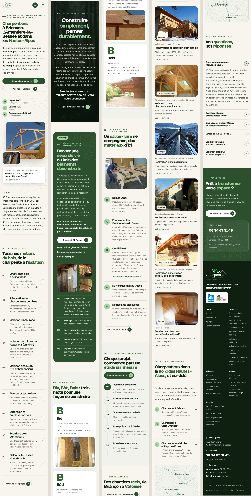
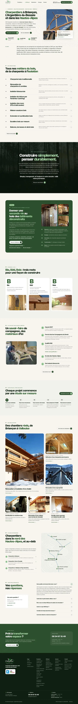
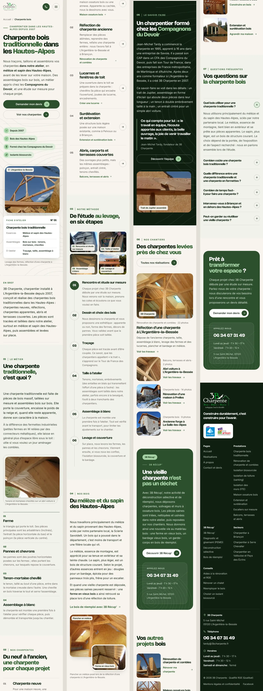
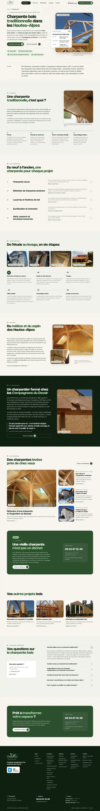
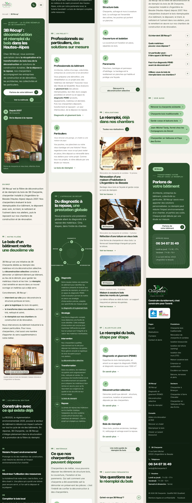
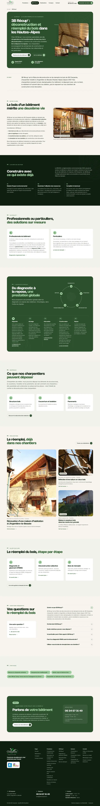
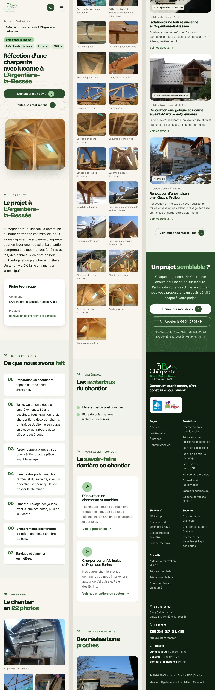
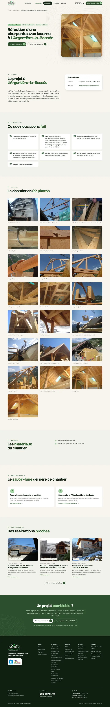

# Rapport de contrôle

Contrôle du 12 octobre 2026, sur la version de production du site construite en local (`pnpm build` puis `pnpm start`, même code et même base que le déploiement Vercel). Les chiffres viennent d’outils, pas d’estimations : les scripts sont décrits en fin de document et peuvent être rejoués.

**En résumé**

- 49 pages indexables, toutes avec un title de 50 à 60 caractères, une meta description de 141 à 155 caractères, un seul H1, une adresse canonique et une image de partage.
- Données structurées présentes sur chaque page et conformes aux propriétés exigées par Google ; les 24 pages avec FAQ reprennent mot pour mot les questions et réponses visibles.
- 0 lien interne cassé, 0 page orpheline (chaque page reçoit au moins un lien depuis le contenu d’une autre).
- Lighthouse mobile : **accessibilité 100, bonnes pratiques 100, SEO 100** sur les quatre pages mesurées ; **performance 89 à 92**, sous l’objectif de 95 (explication et pistes au § 2).
- Démonstration de bout en bout de l’administration : 15 vérifications sur 15 (voir `guide-admin.md`).

---

## 1. Corrections faites pendant ce contrôle

Le contrôle a d’abord servi à trouver des défauts. Tous ceux-ci sont corrigés dans cette livraison :

| Constat | Correction |
|---|---|
| Une adresse sans barre finale (`/politique-de-confidentialite`) redirigeait **vers elle-même** en boucle : Next.js retirait la barre que le proxy venait d’ajouter. | `src/proxy.ts` construit l’adresse cible sans passer par l’objet URL de Next.js. Vérifié : `/politique-de-confidentialite` → `/politique-de-confidentialite/` → `/mentions-legales/#confidentialite`. |
| Payload ajoutait à **toutes** les pages un en-tête `Critical-CH` : Chrome envoyait la première requête deux fois (≈ 600 ms perdus sur mobile, signalés par Lighthouse comme une redirection). | En-tête réservé à l’administration (`next.config.ts`). |
| L’animation d’apparition rendait les blocs presque transparents tant que JavaScript n’avait pas tourné : contenu invisible quelques instants sur un téléphone lent, et faux défauts de contraste (accessibilité 96). | Seuls les blocs encore sous l’écran sont masqués, et entièrement (`RevealObserver.tsx`). Accessibilité 100. |
| La bibliothèque d’envoi de fichiers du formulaire (27 Ko compressés) était chargée sur toutes les pages. | Chargée seulement quand un visiteur joint un fichier. |
| Inter téléchargeait 20 Ko de caractères grecs sur l’accueil pour le seul mot « βίος ». | Inter servie en sous-ensemble latin, auto-hébergée (licence OFL jointe). |
| Motifs « courbes de niveau » et « cernes du bois » : 18 Ko compressés. | Tracés réécrits sans perte (rendu identique au pixel près, vérifié) : 7 Ko. |
| Script Vercel Analytics demandé hors de Vercel (erreur 404 en console). | Chargé seulement sur Vercel. |
| Sur téléphone, la galerie d’un chantier empilait jusqu’à 22 grandes photos. | Deux colonnes, la première photo en pleine largeur : fiche chantier 30 % plus courte. |
| Photo d’en-tête servie en 960 px à un téléphone qui en affiche 720. | Taille intermédiaire de 768 px ajoutée. |
| Administration : « Sans titre » sur chaque section, onglet « API », « Sauvegarder » au lieu d’« Enregistrer », liste des photos en noms de fichiers, redirections sans leur destination et sans entrée de menu, libellés du formulaire adressés au visiteur (« Votre message ») dans la boîte des demandes. | Titre de chaque section, onglet retiré, vocabulaire unifié, photothèque en vignettes, colonne « Nouvelle adresse » et entrée « Redirections », libellés « Message », « Profil », « Projet ». |
| Données structurées `HowTo` de 3B Récup’ : le texte de chaque étape se terminait par le libellé du lien vers la sous-page. | Les paragraphes qui ne sont qu’un lien sont exclus du texte des étapes. |
| Point « licence Nohemi » laissé ouvert. | Réglé : l’EULA fournie autorise l’usage commercial, fichiers servis sans modification. |

## 2. Lighthouse mobile

Lighthouse 13.5, profil mobile par défaut (Moto G Power simulé, 4G lente simulée : 150 ms de latence, 1,6 Mbit/s). Trois passages par page ; la médiane est retenue, comme Google le recommande.

| Page | Performance (3 passages) | Accessibilité | Bonnes pratiques | SEO | FCP | LCP | TBT | CLS |
|---|---|---|---|---|---|---|---|---|
| Accueil `/` | **91** (89 / 91 / 94) | **100** | **100** | **100** | 1,4 s | 3,4 s | 95 ms | 0 |
| Prestation `/charpente-bois/` | **89** (88 / 89 / 90) | **100** | **100** | **100** | 1,2 s | 3,7 s | 78 ms | 0 |
| 3B Récup’ `/3b-recup/` | **89** (89 / 89 / 94) | **100** | **100** | **100** | 1,2 s | 3,7 s | 59 ms | 0 |
| Fiche chantier `/realisations/refection-d-une-charpente-a-l-argentiere-la-bessee/` | **92** (90 / 92 / 93) | **100** | **100** | **100** | 1,2 s | 3,3 s | 46 ms | 0 |

### Objectifs du kit

| Objectif | Mesure | Statut |
|---|---|---|
| CLS sous 0,05 | 0 sur les quatre pages | ✅ |
| INP sous 200 ms | Mesurable seulement chez de vrais visiteurs ; le temps de blocage (TBT), qui l’annonce en laboratoire, reste sous 100 ms | ✅ (indicateur de laboratoire) |
| Accessibilité, bonnes pratiques, SEO ≥ 95 | 100, 100, 100 | ✅ |
| Performance ≥ 95 | 89 à 92 | ❌ écart de 3 à 6 points |
| LCP sous 2,5 s en 4G | 3,3 à 3,7 s en 4G lente simulée | ❌ en laboratoire (voir ci-dessous) |
| Moins de 100 Ko de JavaScript compressé sur une prestation | 133 Ko (brotli, tel que servi par Vercel), dont **11 Ko** pour le code du site | ❌ |

### Pourquoi la performance plafonne à 89–92, et ce qu’il resterait à faire

- **Le texte principal s’affiche dès le premier rendu** : dans les mesures réelles du navigateur, le premier affichage et le plus grand élément affiché arrivent au même instant (220 à 320 ms en local). L’écart vient du modèle de Lighthouse, qui compte dans le LCP tout ce que la page a commencé à télécharger avant cet instant.
- Or **122 Ko de ces 133 Ko de JavaScript sont React et Next.js eux-mêmes**, chargés par toutes les pages d’un site Next.js : c’est le plancher de la pile imposée (Next.js + Payload). Le code propre au site ne pèse que 11 Ko et tout ce qui pouvait l’être a été allégé (§ 1).
- Le reste de ce qui précède l’affichage : le document HTML (33 à 43 Ko), les trois fichiers de police (97 Ko au total, Nohemi ne pouvant pas être allégée car sa licence interdit de modifier les fichiers) et la photo d’en-tête.
- **Chez de vrais visiteurs**, sur le réseau de Vercel (HTTP/2, brotli, polices en cache après la première visite), le LCP attendu est nettement sous 2,5 s. Les vraies valeurs apparaîtront dans Google Search Console (rapport « Signaux Web essentiels ») après quelques semaines de trafic : c’est le chiffre qui compte pour Google.
- Pour atteindre 95 en laboratoire, il faudrait sortir le site public de React (pages HTML sans hydratation, par exemple Astro avec Payload en API seule) : un changement d’architecture, contraire à la demande de départ. Je le déconseille au regard du gain.

## 3. Pages, une par une

Relevé automatique des 49 pages du plan du site. *Mots* : texte visible du contenu principal (sans en-tête ni pied de page). *Liens sortants* : pages du site citées dans le contenu. *Liens entrants* : pages dont le contenu renvoie vers celle-ci (le menu et le pied de page en ajoutent sur toutes). Toutes les pages portent en plus les données de l’entreprise (`GeneralContractor` / `RoofingContractor`, avec horaires, zone desservie, qualification RGE et fondateur), `WebSite` et `WebPage`.

| Page | Title | Car. | Meta (car.) | H1 | Mots | Données structurées propres à la page | Liens sortants | Liens entrants |
|---|---|---|---|---|---|---|---|---|
| `/` | Charpentier Hautes-Alpes (05), Briançon \| 3B Charpente | 54 | 152 | Charpentiers à Briançon, L’Argentière-la-Bessée et dans les Hautes-Alpes | 1628 | FAQ | 25 | 48 |
| `/3b-recup/` | 3B Récup’ : réemploi du bois Hautes-Alpes \| 3B Charpente | 56 | 150 | 3B Récup’ : déconstruction et réemploi du bois dans les Hautes-Alpes | 1587 | Fil d’Ariane, FAQ, HowTo | 15 | 26 |
| `/3b-recup/bois-de-reemploi/` | Vieux bois et bois de réemploi, Hautes-Alpes \| 3B Charpente | 59 | 152 | Vieux bois et bois de réemploi dans les Hautes-Alpes | 1355 | Fil d’Ariane, FAQ | 12 | 12 |
| `/3b-recup/deconstruction-selective/` | Déconstruction sélective bois, Hautes-Alpes \| 3B Charpente | 58 | 153 | Déconstruction sélective et dépose du bois dans les Hautes-Alpes | 1481 | Fil d’Ariane, FAQ | 13 | 5 |
| `/3b-recup/diagnostic-pemd/` | Diagnostic PEMD et ressources, Hautes-Alpes \| 3B Charpente | 58 | 155 | Diagnostic PEMD et gisement de bois réemployable dans les Hautes-Alpes | 1538 | Fil d’Ariane, FAQ, HowTo | 8 | 5 |
| `/a-propos/` | Jean-Michel Tardy, charpentier depuis 2007 \| 3B Charpente | 57 | 144 | 3B Charpente , charpentiers dans les Hautes-Alpes depuis 2007 | 1453 | Fil d’Ariane, FAQ | 17 | 6 |
| `/balcon-terrasse-abri-bois/` | Terrasse, balcon et carport bois Hautes-Alpes \| 3B Charpente | 60 | 148 | Balcons, terrasses et abris en bois dans les Hautes-Alpes | 1875 | Service, Fil d’Ariane, FAQ | 14 | 17 |
| `/charpente-bois/` | Charpente bois traditionnelle, Hautes-Alpes \| 3B Charpente | 58 | 155 | Charpente bois traditionnelle dans les Hautes-Alpes | 1775 | Service, Fil d’Ariane, FAQ | 13 | 16 |
| `/charpentier-briancon/` | Charpentier à Briançon, toiture et isolation \| 3B Charpente | 59 | 151 | Charpentier à Briançon et dans le Briançonnais | 1352 | Fil d’Ariane, FAQ | 16 | 9 |
| `/charpentier-serre-chevalier/` | Charpentier à Serre Chevalier et au Monêtier \| 3B Charpente | 59 | 145 | Charpentier à Serre Chevalier , de Saint-Chaffrey au Monêtier-les-Bains | 1278 | Fil d’Ariane, FAQ | 14 | 9 |
| `/charpentier-vallouise-pays-des-ecrins/` | Charpentier L’Argentière-la-Bessée, Vallouise \| 3B Charpente | 60 | 152 | Charpentier à L’Argentière-la-Bessée , en Vallouise et dans le Pays des Écrins | 1390 | Fil d’Ariane, FAQ | 26 | 20 |
| `/conseils/` | Conseils rénovation et construction bois \| 3B Charpente | 55 | 148 | Nos conseils pour construire et rénover en bois dans les Hautes-Alpes | 230 | Collection, Fil d’Ariane, ItemList | 6 | 4 |
| `/conseils/aides-renovation-artisan-rge/` | Artisan RGE et aides rénovation, Hautes-Alpes \| 3B Charpente | 60 | 143 | Aides à la rénovation : pourquoi choisir un artisan RGE dans les Hautes-Alpes ? | 2168 | Article, Fil d’Ariane, FAQ | 11 | 6 |
| `/conseils/isolant-biosource-montagne/` | Quel isolant biosourcé choisir en montagne ? \| 3B Charpente | 59 | 154 | Quel isolant biosourcé choisir pour une maison de montagne dans les Hautes-Alpes ? | 2624 | Article, Fil d’Ariane, FAQ | 14 | 6 |
| `/conseils/reemploi-bois-construction/` | Réemploi du bois en construction : le guide \| 3B Charpente | 58 | 150 | Réemployer le bois en construction : ce qu’on peut réutiliser , comment, et à quelles conditions | 2166 | Article, Fil d’Ariane, FAQ | 10 | 6 |
| `/conseils/renover-chalet-maison-ancienne/` | Rénovation maison ancienne en montagne \| 3B Charpente | 53 | 154 | Rénover un chalet ou une maison ancienne dans les Hautes-Alpes : par où commencer ? | 2201 | Article, Fil d’Ariane, FAQ | 24 | 3 |
| `/contact/` | Devis charpente Hautes-Alpes : contact \| 3B Charpente | 53 | 144 | Demandez votre devis de charpente dans les Hautes-Alpes | 998 | Fil d’Ariane, FAQ | 6 | 48 |
| `/escalier-bois-sur-mesure/` | Escalier bois sur mesure, Hautes-Alpes \| 3B Charpente | 53 | 153 | Escalier bois sur mesure dans les Hautes-Alpes | 1623 | Service, Fil d’Ariane, FAQ | 14 | 12 |
| `/extension-surelevation-bois/` | Extension et surélévation bois, Hautes-Alpes \| 3B Charpente | 59 | 151 | Extension et surélévation bois à Briançon et dans les Hautes-Alpes | 1563 | Service, Fil d’Ariane, FAQ | 14 | 11 |
| `/isolation-biosourcee/` | Isolation biosourcée RGE Hautes-Alpes \| 3B Charpente | 52 | 147 | Isolation biosourcée et rénovation énergétique dans les Hautes-Alpes | 2001 | Service, Fil d’Ariane, FAQ | 14 | 16 |
| `/isolation-murs-ite/` | Isolation par l’extérieur (ITE) Hautes-Alpes \| 3B Charpente | 59 | 155 | Isolation des murs par l’extérieur (ITE) et du bâti ancien dans les Hautes-Alpes | 2051 | Service, Fil d’Ariane, FAQ | 15 | 11 |
| `/isolation-toiture-sarking/` | Isolation toiture et sarking Hautes-Alpes \| 3B Charpente | 56 | 153 | Isolation de toiture et sarking dans les Hautes-Alpes | 1974 | Service, Fil d’Ariane, FAQ | 14 | 14 |
| `/maison-ossature-bois/` | Maison ossature bois dans les Hautes-Alpes \| 3B Charpente | 57 | 145 | Maison ossature bois dans les Hautes-Alpes | 1598 | Service, Fil d’Ariane, FAQ | 12 | 11 |
| `/mentions-legales/` | Mentions légales et confidentialité \| 3B Charpente | 50 | 141 | Mentions légales et confidentialité | 1374 | Fil d’Ariane | 2 | 1 |
| `/realisations/` | Réalisations charpente bois Hautes-Alpes \| 3B Charpente | 55 | 150 | Nos réalisations de charpente dans les Hautes-Alpes | 1724 | Collection, Fil d’Ariane, ItemList, FAQ | 39 | 35 |
| `/realisations/abris-voiture-a-l-argentiere-la-bessee/` | Abri voiture à L’Argentière-la-Bessée \| 3B Charpente | 52 | 151 | Abri voiture en charpente traditionnelle à L’Argentière-la-Bessée | 383 | CreativeWork, Fil d’Ariane | 8 | 6 |
| `/realisations/construction-d-une-terrasse-couverte-a-champcella/` | Terrasse couverte en bois à Champcella \| 3B Charpente | 53 | 152 | Terrasse couverte et abri voiture à Champcella | 425 | CreativeWork, Fil d’Ariane | 8 | 9 |
| `/realisations/creation-d-un-abris-de-jardin-a-pelvoux/` | Abri de jardin à Pelvoux (Vallouise-Pelvoux) \| 3B Charpente | 59 | 144 | Création d’un abri de jardin à Pelvoux | 381 | CreativeWork, Fil d’Ariane | 8 | 5 |
| `/realisations/creation-d-un-balcon-a-la-roche-de-rame/` | Balcon en mélèze à La Roche-de-Rame \| 3B Charpente | 50 | 147 | Création d’un balcon en mélèze à La Roche-de-Rame | 405 | CreativeWork, Fil d’Ariane | 8 | 5 |
| `/realisations/creation-d-un-balcon-terrasse-a-gresse-en-vercors/` | Balcon-terrasse à Gresse-en-Vercors (Isère) \| 3B Charpente | 58 | 154 | Création d’un balcon-terrasse à Gresse-en-Vercors | 407 | CreativeWork, Fil d’Ariane | 7 | 3 |
| `/realisations/creation-d-un-escalier-en-bois-debout-dans-un-bati-ancien/` | Escalier en bois debout dans un bâti ancien \| 3B Charpente | 58 | 150 | Création d’un escalier en bois debout dans un bâti ancien | 400 | CreativeWork, Fil d’Ariane | 7 | 6 |
| `/realisations/creation-d-un-plancher-dans-un-bati-ancien/` | Plancher douglas et épicéa en bâti ancien \| 3B Charpente | 56 | 147 | Création d’un plancher en douglas et épicéa dans un bâti ancien | 381 | CreativeWork, Fil d’Ariane | 7 | 2 |
| `/realisations/escalier-1-4-tournant-en-meleze-lamelle-colle/` | Escalier quart tournant en mélèze sur mesure \| 3B Charpente | 59 | 153 | Escalier quart tournant en mélèze lamellé-collé | 423 | CreativeWork, Fil d’Ariane | 7 | 6 |
| `/realisations/fabrication-d-un-escalier/` | Escalier en frêne et aluminium sur mesure \| 3B Charpente | 56 | 151 | Fabrication d’un escalier en frêne et aluminium | 375 | CreativeWork, Fil d’Ariane | 7 | 4 |
| `/realisations/isolation-d-un-bati-ancien-par-l-interieur/` | Isolation intérieure d’un bâti ancien \| 3B Charpente | 52 | 153 | Isolation par l’intérieur d’un bâti ancien en ouate de cellulose | 490 | CreativeWork, Fil d’Ariane | 7 | 8 |
| `/realisations/isolation-d-une-toiture-ancienne-a-l-argentiere-la-bessee/` | Toit ancien isolé à L’Argentière-la-Bessée \| 3B Charpente | 57 | 154 | Isolation d’une toiture ancienne en fibre de bois à L’Argentière-la-Bessée | 479 | CreativeWork, Fil d’Ariane | 8 | 11 |
| `/realisations/maison-a-ossature-bois-dans-les-monts-du-lyonnais/` | Maison ossature bois, monts du Lyonnais \| 3B Charpente | 54 | 155 | Maison à ossature bois dans les monts du Lyonnais | 514 | CreativeWork, Fil d’Ariane | 8 | 7 |
| `/realisations/refection-d-une-charpente-a-l-argentiere-la-bessee/` | Charpente refaite à L’Argentière-la-Bessée \| 3B Charpente | 57 | 155 | Réfection d’une charpente avec lucarne à L’Argentière-la-Bessée | 603 | CreativeWork, Fil d’Ariane | 8 | 18 |
| `/realisations/refection-d-une-toiture-a-ronatlon/` | Toiture refaite avec une ferme en vieux bois \| 3B Charpente | 59 | 151 | Réfection d’une toiture en vieux bois | 394 | CreativeWork, Fil d’Ariane | 8 | 7 |
| `/realisations/rehabilitation-d-une-ancienne-forge-a-la-salle-les-alpes/` | Forge réhabilitée à La Salle-les-Alpes \| 3B Charpente | 53 | 148 | Réhabilitation d’une ancienne forge à La Salle-les-Alpes | 451 | CreativeWork, Fil d’Ariane | 8 | 7 |
| `/realisations/renovation-d-un-toit-en-bardeau-meleze-au-casset/` | Toit en bardeaux de mélèze au Casset \| 3B Charpente | 51 | 155 | Rénovation d’un toit en bardeaux de mélèze au Casset (Le Monêtier-les-Bains) | 425 | CreativeWork, Fil d’Ariane | 8 | 5 |
| `/realisations/renovation-d-une-copropriete-a-briancon/` | Rénovation d’une copropriété à Briançon \| 3B Charpente | 54 | 147 | Rénovation d’une copropriété à Briançon : charpente, isolation et couverture | 430 | CreativeWork, Fil d’Ariane | 8 | 10 |
| `/realisations/renovation-d-une-maison-d-habitation-a-l-argentiere-la-bessee/` | Bardage vieux bois à L’Argentière-la-Bessée \| 3B Charpente | 58 | 155 | Rénovation d’une maison d’habitation à L’Argentière-la-Bessée : vieux bois et réemploi | 507 | CreativeWork, Fil d’Ariane | 9 | 13 |
| `/realisations/renovation-d-une-maison-d-habitation-sur-la-commune-de-prelles/` | Rénovation d’une maison en mélèze à Prelles \| 3B Charpente | 58 | 152 | Rénovation d’une maison d’habitation en mélèze de pays à Prelles | 504 | CreativeWork, Fil d’Ariane | 8 | 9 |
| `/realisations/renovation-energetique-et-ouverture-d-une-lucarne-a-saint-martin-de-queyriere/` | Lucarne à Saint-Martin-de-Queyrières \| 3B Charpente | 51 | 148 | Rénovation énergétique et ouverture d’une lucarne à Saint-Martin-de-Queyrières | 406 | CreativeWork, Fil d’Ariane | 8 | 10 |
| `/realisations/renovation-et-isolation-d-un-chalet-a-vallouise/` | Chalet rénové et isolé à Vallouise (05) \| 3B Charpente | 54 | 152 | Rénovation et isolation d’un chalet à Vallouise , et agrandissement de sa terrasse | 529 | CreativeWork, Fil d’Ariane | 8 | 17 |
| `/realisations/surelevation-a-pelvoux/` | Surélévation à Pelvoux (Vallouise-Pelvoux) \| 3B Charpente | 57 | 153 | Surélévation à Pelvoux , avec une dépassée de toit sur consoles | 418 | CreativeWork, Fil d’Ariane | 8 | 5 |
| `/realisations/surelevation-en-ossature-bois-d-une-maison-a-briancon/` | Surélévation en ossature bois à Briançon \| 3B Charpente | 55 | 152 | Surélévation en ossature bois d’une maison à Briançon | 537 | CreativeWork, Fil d’Ariane | 8 | 9 |
| `/renovation-charpente-combles/` | Rénovation charpente et combles, Hautes-Alpes \| 3B Charpente | 60 | 154 | Rénovation de charpente et aménagement des combles dans les Hautes-Alpes | 1713 | Service, Fil d’Ariane, FAQ | 13 | 21 |

**Lecture** : la page la plus courte est `/conseils/` (230 mots), une page d’index qui présente les quatre guides ; c’est voulu. Toutes les autres dépassent 600 mots, la médiane est à 998.

**Validation des données structurées.** Chaque bloc JSON-LD est relu et vérifié contre les propriétés que Google exige pour ses résultats enrichis : `BreadcrumbList` (position, nom, adresse), `FAQPage` (question, réponse, **et présence mot pour mot dans le texte visible**), `Article` (titre ≤ 110 caractères, image, date, auteur), entreprise (nom, adresse complète, téléphone, adresse du site), `ItemList`, `HowTo`, `Service`, `CreativeWork`. Résultat : **aucune erreur sur les 49 pages.** À refaire une fois le domaine branché avec l’outil officiel de Google (https://search.google.com/test/rich-results) sur trois pages types : une prestation, une fiche chantier, un guide.

Meta descriptions des 49 pages

- `/` : Charpentiers à L’Argentière-la-Bessée depuis 2007 : charpente, isolation biosourcée RGE, ossature bois, réemploi du bois local. Parlons de votre projet.
- `/3b-recup/` : Déconstruction et réemploi du bois dans les Hautes-Alpes : 3B Récup’, la filière de 3B Charpente, dépose, transforme et repose votre bois. Parlons-en.
- `/3b-recup/bois-de-reemploi/` : Bardage vieux bois, garde-corps, fermes : 3B Récup’ trie, nettoie et usine le bois de réemploi dans ses ateliers, puis le pose. Charpentier depuis 2007.
- `/3b-recup/deconstruction-selective/` : Déconstruction sélective dans les Hautes-Alpes : charpente, solivage, ossature et bardage déposés par les charpentiers de 3B Récup’ pour être réemployés.
- `/3b-recup/diagnostic-pemd/` : Diagnostic PEMD : qui est concerné, diagnostic ressources sous 1 000 m², expertise du bois réemployable par 3B Récup’, charpentier depuis 2007. Parlons-en.
- `/a-propos/` : Fondée en 2007 par Jean-Michel Tardy, formé chez les Compagnons du Devoir, 3B Charpente construit avec le bois des Hautes-Alpes. Notre histoire.
- `/balcon-terrasse-abri-bois/` : Balcons, terrasses, garde-corps et abris voiture en mélèze, sur mesure, par un charpentier de L’Argentière-la-Bessée depuis 2007. Demandez un devis.
- `/charpente-bois/` : Charpente bois traditionnelle en mélèze et sapin des Hautes-Alpes, taillée et assemblée dans notre atelier. Charpentiers depuis 2007. Demandez votre devis.
- `/charpentier-briancon/` : 3B Charpente, charpentier depuis 2007 : reprise de charpente, isolation biosourcée et surélévation bois à Briançon. Bois local, RGE. Demandez un devis.
- `/charpentier-serre-chevalier/` : Charpentier à Serre Chevalier : forge réhabilitée à La Salle-les-Alpes, toit en bardeaux de mélèze au Casset. Bois local, RGE. Demandez un devis.
- `/charpentier-vallouise-pays-des-ecrins/` : Charpentier à L’Argentière-la-Bessée depuis 2007 : charpente, isolation biosourcée, chalets, balcons et réemploi en Vallouise et Pays des Écrins. Devis.
- `/conseils/` : Isolants biosourcés, réemploi du bois, rénovation de chalet, aides RGE : les guides pratiques de 3B Charpente, charpentier à L’Argentière-la-Bessée.
- `/conseils/aides-renovation-artisan-rge/` : Qu’est-ce qu’un artisan RGE, comment le vérifier sur France Rénov’ et préparer un projet aidé ? Le guide d’un charpentier RGE des Hautes-Alpes.
- `/conseils/isolant-biosource-montagne/` : Ouate de cellulose, fibre de bois ou chanvre : quel isolant biosourcé choisir pour sa maison en montagne ? Conseils d’un charpentier RGE des Hautes-Alpes.
- `/conseils/reemploi-bois-construction/` : Réemployer le bois en construction : quoi réutiliser, comment, à quelles conditions (PEMD, RE2020). Le guide de 3B Charpente, charpentier depuis 2007.
- `/conseils/renover-chalet-maison-ancienne/` : Rénover un chalet ou une maison ancienne en montagne : l’ordre des travaux, l’isolation biosourcée, le vieux bois à garder. Le guide d’un charpentier RGE.
- `/contact/` : Charpente, isolation biosourcée ou réemploi : contactez 3B Charpente à L’Argentière-la-Bessée au 06 34 67 31 49. Rencontre, puis devis détaillé.
- `/escalier-bois-sur-mesure/` : Escalier bois sur mesure dans les Hautes-Alpes : quart tournant en mélèze lamellé-collé, frêne, bois debout. Dessiné et taillé dans notre atelier. Devis.
- `/extension-surelevation-bois/` : Extension et surélévation bois à Briançon et dans les Hautes-Alpes : ossature légère, bois local, isolants biosourcés. Charpentiers depuis 2007. Devis.
- `/isolation-biosourcee/` : Charpentier RGE à L’Argentière-la-Bessée depuis 2007 : isolation en ouate de cellulose, fibre de bois et chanvre, toits et murs. Demandez un devis.
- `/isolation-murs-ite/` : Isolation des murs par l’extérieur en fibre de bois, bardage mélèze ou enduit, et bâti ancien isolé en ouate. Charpentier RGE dans les Hautes-Alpes. Devis.
- `/isolation-toiture-sarking/` : Isolation de toiture par l’extérieur (sarking) ou par l’intérieur, en fibre de bois et ouate. Charpentier RGE à L’Argentière-la-Bessée. Devis sur mesure.
- `/maison-ossature-bois/` : Maison ossature bois dans les Hautes-Alpes : bois local, isolants biosourcés, toiture en sarking. Charpentiers depuis 2007. Demandez votre devis.
- `/mentions-legales/` : Mentions légales de 3B Charpente (EI Jean-Michel Tardy, SIREN 494 482 714) et politique de confidentialité : formulaire, cookies, vos droits.
- `/realisations/` : Nos chantiers en photos : charpentes en mélèze du pays, isolation biosourcée, ossature bois et bois de réemploi, de Briançon à Vallouise. À découvrir.
- `/realisations/abris-voiture-a-l-argentiere-la-bessee/` : Abri voiture en bois à L’Argentière-la-Bessée : ferme avec poinçon et entrait cintré, assemblages tenon-mortaise chevillés. Voir le chantier en photos.
- `/realisations/construction-d-une-terrasse-couverte-a-champcella/` : À Champcella, terrasse couverte avec local technique et abri voiture dans le prolongement du toit : plancher en mélèze de pays, tenons passants. Photos.
- `/realisations/creation-d-un-abris-de-jardin-a-pelvoux/` : Création d’un abri de jardin à Pelvoux par 3B Charpente, charpentier installé à L’Argentière-la-Bessée depuis 2007 : du levage à l’abri terminé.
- `/realisations/creation-d-un-balcon-a-la-roche-de-rame/` : À La Roche-de-Rame, 3B Charpente a créé un balcon en mélèze porté par des portiques, avec sa balustrade en mélèze. Charpentier depuis 2007. Photos.
- `/realisations/creation-d-un-balcon-terrasse-a-gresse-en-vercors/` : Création d’un balcon-terrasse à Gresse-en-Vercors, en Isère : du dessin du projet à l’ouvrage terminé, vu d’en bas, d’en haut et de face. Voir les photos.
- `/realisations/creation-d-un-escalier-en-bois-debout-dans-un-bati-ancien/` : Escalier en bois debout dans un bâti ancien : dépose de l’ancien escalier, caissons en panneau trois plis, contremarches, pose du bois debout. Photos.
- `/realisations/creation-d-un-plancher-dans-un-bati-ancien/` : Création d’un plancher en douglas et épicéa dans un bâti ancien, du choix des bois au levage. Un chantier de 3B Charpente, charpentier depuis 2007.
- `/realisations/escalier-1-4-tournant-en-meleze-lamelle-colle/` : Escalier quart tournant en mélèze lamellé-collé : dessiné, tracé et taillé dans notre atelier, monté en deux jours finitions comprises. Voir le chantier.
- `/realisations/fabrication-d-un-escalier/` : Fabrication d’un escalier sur mesure en frêne et aluminium par 3B Charpente, charpentier dans les Hautes-Alpes depuis 2007. Voir le résultat en photos.
- `/realisations/isolation-d-un-bati-ancien-par-l-interieur/` : Isolation d’un bâti ancien par l’intérieur : poutres en I, OSB3, étanchéité à l’air, ouate de cellulose insufflée, bardage en pin. 12 photos du chantier.
- `/realisations/isolation-d-une-toiture-ancienne-a-l-argentiere-la-bessee/` : À L’Argentière-la-Bessée, isolation d’une toiture ancienne : renfort de charpente, étanchéité à l’air, panneaux en fibre de bois, fenêtre de toit. Photos.
- `/realisations/maison-a-ossature-bois-dans-les-monts-du-lyonnais/` : Maison à ossature bois dans les monts du Lyonnais : solivage sur poteaux, charpente apparente, fibre de bois, bardage douglas, socle en pierres récupérées.
- `/realisations/refection-d-une-charpente-a-l-argentiere-la-bessee/` : Réfection d’une charpente à L’Argentière-la-Bessée : dépose, taille à la besaiguë, trait de Jupiter, levage des fermes, lucarne, bardage mélèze. 22 photos.
- `/realisations/refection-d-une-toiture-a-ronatlon/` : Réfection d’une toiture avec une ferme en vieux bois de réemploi : pied d’arbalétrier, pose de la charpente et du bardage. Un chantier de 3B Charpente.
- `/realisations/rehabilitation-d-une-ancienne-forge-a-la-salle-les-alpes/` : Réhabilitation d’une ancienne forge à La Salle-les-Alpes : charpente taillée, levage de la toiture, couverture, deux escaliers et un balcon. Photos.
- `/realisations/renovation-d-un-toit-en-bardeau-meleze-au-casset/` : Au Casset, au Monêtier-les-Bains, 3B Charpente a rénové un toit en bardeaux de mélèze. Photos avant et après d’un chantier de la vallée de Serre Chevalier.
- `/realisations/renovation-d-une-copropriete-a-briancon/` : À Briançon, 3B Charpente a repris la charpente, l’isolation et la couverture d’une copropriété : fermes reprises, dépassée de toit recréée. Photos.
- `/realisations/renovation-d-une-maison-d-habitation-a-l-argentiere-la-bessee/` : Rénovation d’une maison à L’Argentière-la-Bessée : pignon vitré, bardage en vieux bois, garde-corps en bois de réemploi, escalier balancé. Voir les photos.
- `/realisations/renovation-d-une-maison-d-habitation-sur-la-commune-de-prelles/` : À Prelles, rénovation d’une maison en mélèze de pays : taille de la charpente, assemblage à blanc, solivage, terrasse et garde-corps bois-métal. Photos.
- `/realisations/renovation-energetique-et-ouverture-d-une-lucarne-a-saint-martin-de-queyriere/` : Rénovation énergétique et ouverture d’une lucarne à Saint-Martin-de-Queyrières : étanchéité à l’air, caissons d’isolation, toiture terminée. Photos.
- `/realisations/renovation-et-isolation-d-un-chalet-a-vallouise/` : Chalet des années 1980 à Vallouise : 28 cm d’isolants biosourcés dans les murs, 32 cm en toiture, bardage mélèze et terrasse agrandie. Voir le chantier.
- `/realisations/surelevation-a-pelvoux/` : Surélévation à Pelvoux par 3B Charpente, charpentier à L’Argentière-la-Bessée depuis 2007 : levage, consoles de dépassée de toit, vue intérieure. Photos.
- `/realisations/surelevation-en-ossature-bois-d-une-maison-a-briancon/` : Surélévation d’une maison à Briançon en ossature bois : murs pignons, pannes de 14 × 30 cm, panneaux trois plis épicéa, laine de bois. Voir le chantier.
- `/renovation-charpente-combles/` : Rénovation de charpente, aménagement des combles, lucarnes et fenêtres de toit dans les Hautes-Alpes. Artisan RGE, isolants biosourcés. Demandez un devis.

## 4. Captures d’écran

Pages entières, thème clair. Téléphone : 390 px de large, la page découpée en colonnes pour tenir dans l’écran. Ordinateur : 1 440 px, réduite de moitié.

### Accueil

### Prestation : Charpente bois

### 3B Récup’

### Fiche chantier

Aucun débordement horizontal ni aucune erreur dans la console sur les huit captures.

## 5. Relecture critique

**Un propriétaire de chalet à Briançon comprend-il en dix secondes ce que fait 3B et comment l’appeler ?**
Oui. Le titre de l’accueil dit le métier et le lieu (« Charpentiers à Briançon, L’Argentière-la-Bessée et dans les Hautes-Alpes »), l’encadré « En bref » le résume en deux phrases, et le numéro est visible en haut de chaque page (bouton d’appel vert sur téléphone). La page « Charpentier à Briançon » montre les chantiers de la commune. Limite connue : aucun avis client n’est affiché, faute d’avis réels ; les preuves sont la qualification RGE Qualibat, le label Éco Artisan et l’ancienneté (depuis 2007).

**Un architecte comprend-il en trente secondes ce que 3B Récup’ peut faire sur son chantier ?**
Oui pour l’offre : le haut de page nomme les architectes, et l’encadré « En bref » dit tout le service en deux phrases (évaluer le bois réemployable, le déposer, le trier, l’usiner, le reposer). La section « Professionnels du bâtiment » s’adresse ensuite directement à eux (« Associez-nous dès l’étude de faisabilité… un seul interlocuteur, de la dépose à la repose »), avant la méthode en cinq étapes et les trois sous-pages (diagnostic, déconstruction sélective, bois de réemploi). La page Diagnostic PEMD cite les décrets n° 2021-821 et 2021-822, le seuil de 1 000 m² et le formulaire de récolement exigé depuis le 1ᵉʳ juillet 2023, là où les premiers résultats actuels se contredisent sur ces dates. Point ouvert, important : Jean réalise-t-il lui-même le diagnostic réglementaire ou intervient-il en appui d’un diagnostiqueur ? En attendant sa réponse, le texte reste prudent (`docs/a-valider.md`).

**Jean peut-il ajouter un chantier seul, en cinq minutes, sans casser la page ?**
Oui. L’assistant tient en trois étapes, les photos sont allégées et ordonnées dans le navigateur, la description pour Google est proposée toute seule, et la mise en page n’est pas modifiable, donc pas cassable. La démonstration l’a fait sans aide et a vérifié le résultat sur le site, jusque dans le filtre de la commune. Garde-fous : impossible de publier sans description Google ou avec un lien interne cassé ; brouillon enregistré tout seul ; 30 versions conservées.

**Chaque page répond-elle à sa recherche principale mieux que le premier résultat actuel de Google ?**
Sur les recherches testées (« charpentier Briançon rénovation charpente », « réemploi bois déconstruction sélective Hautes-Alpes diagnostic PEMD », « isolation biosourcée toiture fibre de bois Hautes-Alpes artisan RGE »), les premiers résultats actuels sont des annuaires (118712, Obat, travaux.com), des pages nationales génériques (Selectra, EDF) ou des PDF de fabricants : aucun ne répond localement. Les pages du site donnent une réponse directe en tête, des chantiers réels dans la commune, des questions fréquentes et des données structurées. Ce test a été fait avec un moteur de recherche généraliste, pas avec google.fr depuis les Hautes-Alpes : le vrai verdict viendra de la Search Console. Pour gagner sur les recherches locales, la fiche Google Business Profile doit renvoyer vers le nouveau site (point à valider).

**Retrouve-t-on bien l’univers de la maquette Framer ?**
Oui : fond crème, vert forêt et sauge, titres en Nohemi, boutons en pilule avec disque sauge, photos en passe-partout à grands rayons. L’univers est prolongé par les courbes de niveau (la montagne) et les cernes du bois (3B Récup’). Chaque page a d’abord été dessinée dans Claude Design (`docs/design.md`).

## 6. Rejouer le contrôle

| Contrôle | Comment |
|---|---|
| Build de production local | `pnpm build && pnpm start` |
| Lighthouse mobile | `lighthouse http://localhost:3000/charpente-bois/ --chrome-flags="--headless=new"`, trois fois, médiane |
| Pages, liens, données structurées | script de relevé qui lit `sitemap.xml`, puis chaque page (title, meta, H1, mots, JSON-LD validé, liens) |
| Démonstration de l’administration | script Playwright décrit dans `guide-admin.md`, qui remet tout en état à la fin |
| Points à valider et redirections | `pnpm export:docs` |
