# Guide de l’administration

Pour Jean-Michel et l’équipe de 3B Charpente. Chaque fiche tient en quelques lignes ; les captures viennent du vrai site, prises pendant la démonstration décrite en fin de document.

**Adresse** : `https://3bcharpente.fr/admin` une fois le nom de domaine branché (en attendant : `https://3b-charpente.vercel.app/admin`).
La même aide, pas à pas, est dans l’administration : bouton **Aide** en bas du menu.

---

## Se connecter

Tapez votre **identifiant** (`jean`) ou votre adresse e-mail, puis votre mot de passe. Après 5 essais faux, le compte se bloque 15 minutes : c’est voulu, contre les robots. La session dure une journée de travail.

Changez le mot de passe donné au lancement dès la première connexion : en bas du menu, cliquez sur votre nom (**Votre compte**), puis **Changer le mot de passe**.

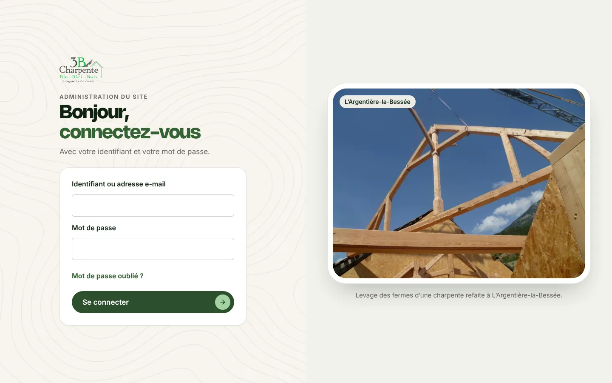

## L’accueil

L’accueil dit ce qui vous attend : les nouvelles demandes, les points à confirmer, puis les quatre choses que l’on fait le plus souvent. Le menu de gauche reste le même partout : **Demandes**, **Mon site** (pages, prestations, chantiers, conseils), **Photos**, **Réglages**.

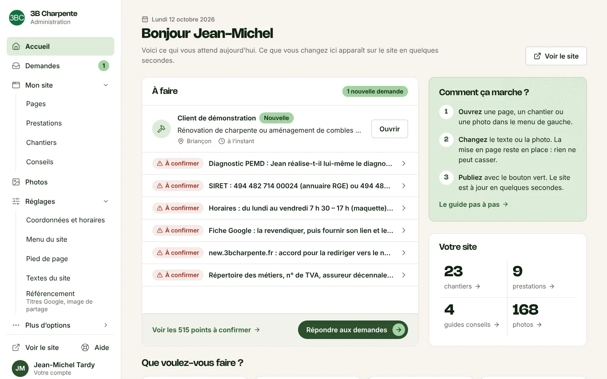

---

## 1. Répondre à une demande

1. Cliquez sur **Demandes**. Les nouvelles sont en haut, avec un point vert.
2. Cliquez sur une demande : message, commune, type de projet et photos jointes s’affichent.
3. **Appeler** compose le numéro sur téléphone ; **Répondre par e-mail** ouvre un e-mail déjà adressé.
4. Notez ce qui a été convenu dans **Notes pour vous** (personne d’autre ne les voit), puis **Marquer comme traitée**.

Chaque demande arrive aussi dans votre boîte e-mail.

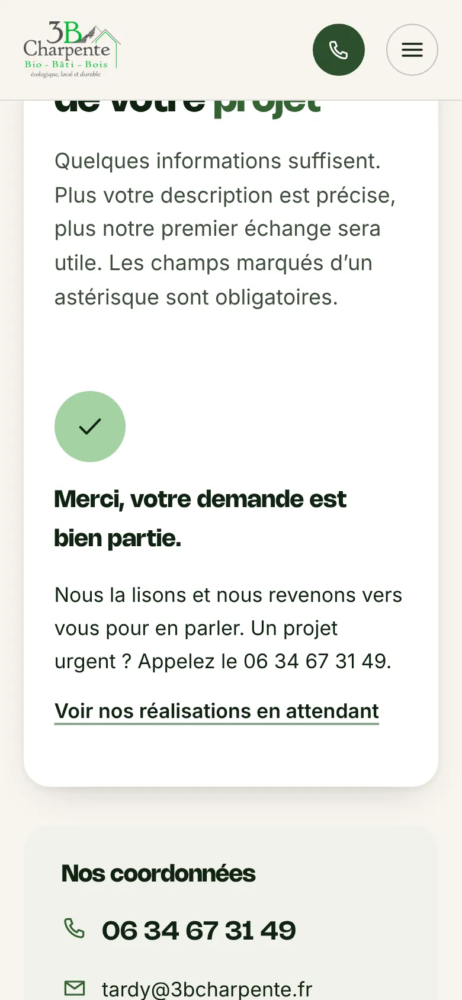
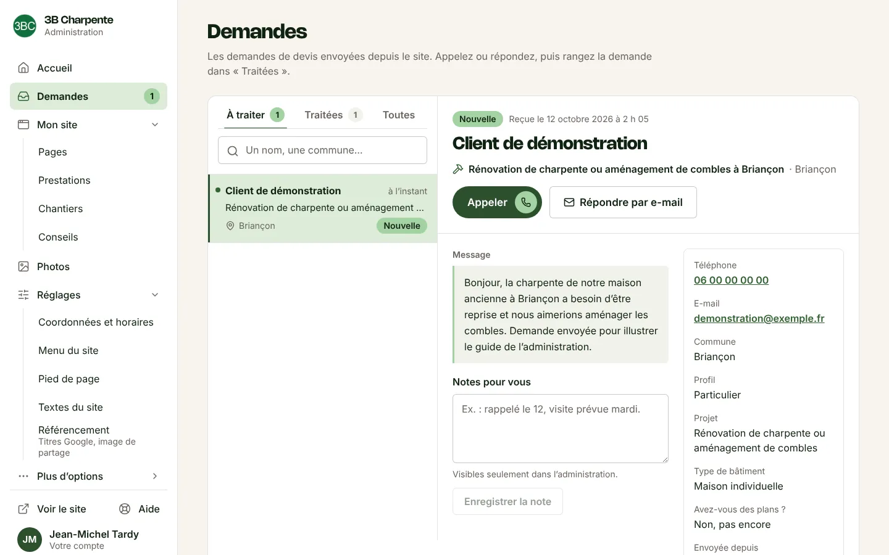

## 2. Modifier un texte

1. **Mon site** → **Pages** (ou **Prestations**, **Chantiers**, **Conseils**). Cherchez la page par son nom.
2. Onglet **Haut de page** pour le titre et l’introduction ; onglet **Sections** pour le reste. Chaque section porte son titre : cliquez dessus pour la déplier.
3. Changez le texte. Il est enregistré tout seul en brouillon : le site ne change pas encore.
4. L’œil (**Aperçu**) montre le résultat ; **Publier les modifications** le met en ligne en quelques secondes.

Les petites phrases fixes (boutons, libellés, page 404) sont dans **Réglages** → **Textes du site**.

**Choisir une page, une prestation, une commune, des questions.** Un clic sur la liste l’ouvre ; tapez quelques lettres, sans vous soucier des accents (« briancon » trouve Briançon), puis cliquez sur le bon nom. Quand on peut en choisir plusieurs (prestations d’un chantier, questions d’une FAQ), ils s’affichent l’un sous l’autre, numérotés : **↑ ↓** changent l’ordre (le premier compte le plus : « La première est la prestation principale »), le crayon ouvre le document pour le corriger sans quitter la page, la croix le retire. **Créer…**, en bas de la liste, ajoute une commune ou une question qui manque. Les étiquettes d’un chantier se tapent une à une, chacune validée par Entrée.

**Écrire court, c’est ce qui se lit.** Trois phrases par paragraphe au plus ; une énumération va dans une liste ; une précision va dans un encadré. Pour aérer une page, **Ajouter une section** propose :

| Section | À quoi elle sert |
|---|---|
| **Texte et image** | Deux ou trois phrases, puis des **points clés** (coches vertes, une ligne chacun) et une ou deux photos. |
| **Encadré (bon à savoir)** | Une précision mise à part. Type : « Bon à savoir », « Sur nos chantiers », « Définition » ou « Aides et qualification ». |
| **Chiffres clés** | 2 à 4 chiffres vérifiés (28 cm, 1 000 m², 2007), chacun avec une courte explication. |
| **Points forts et points d’attention** | Deux colonnes, une ligne par point (pour comparer un matériau, une technique). |
| **Liste à puces ou à cocher** | Coches, numéros, définitions (un terme et son explication) ou pastilles de liens (« Voir aussi »). |
| **Cartes** | Une idée par carte, une vingtaine de mots, avec une icône ou une photo. |

Si un texte paraît long dans l’aperçu, coupez-le en deux paragraphes ou passez-le en points clés.

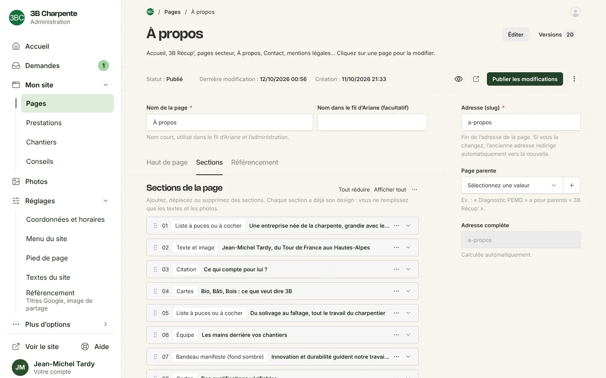
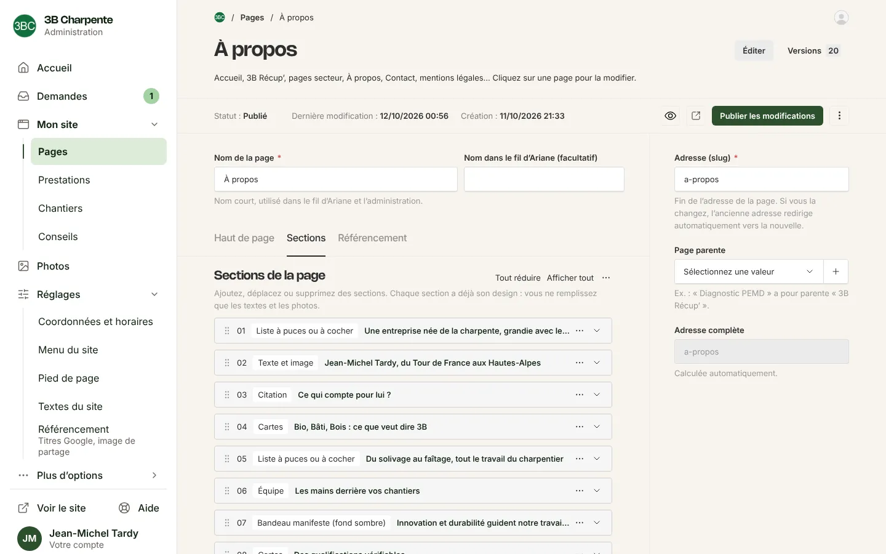

## 3. Les photos

**Voir une photo en grand.** Partout (dans **Photos**, sur une page, sur un chantier), un clic sur la photo l’ouvre en grand. Les flèches à l’écran ou du clavier passent à la suivante ; **Fermer** ou la touche Échap referme.

**Changer la photo d’une page ou d’un chantier.** Chaque champ photo montre la photo choisie, avec ses boutons :

- **Changer** ouvre vos photos : cliquez sur celle à mettre à la place (la loupe l’affiche d’abord en grand). La photo déjà en place est marquée « Déjà choisie ».
- **Envoyer une nouvelle photo** (dans la même fenêtre) ajoute une photo de votre ordinateur et la met directement dans le champ.
- **Description** corrige le texte alternatif et la légende de la photo, sans quitter la page.
- **Retirer** vide le champ (la photo reste dans **Photos**).

Certains champs ne proposent que les photos qui conviennent : le fond assombri d’un haut de page n’accepte que les photos « Ambiance ». Dans les galeries, chaque ligne repliée montre sa vignette et sa légende.

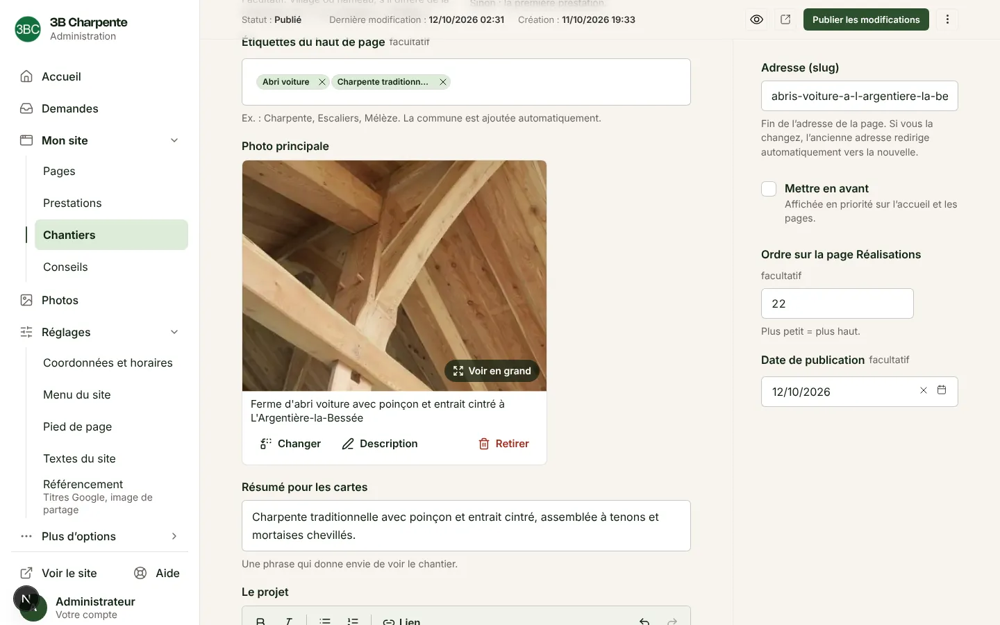
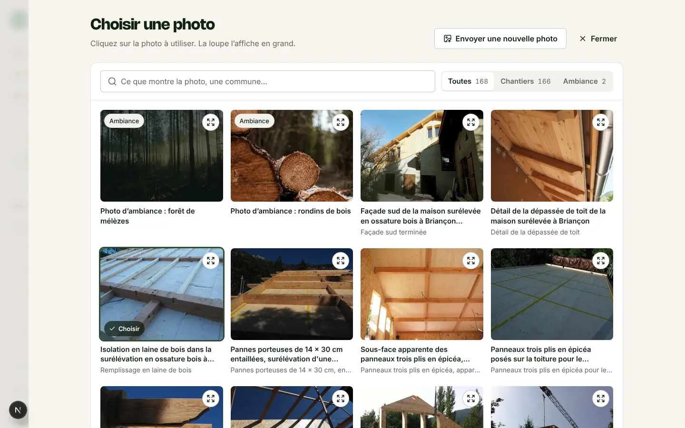
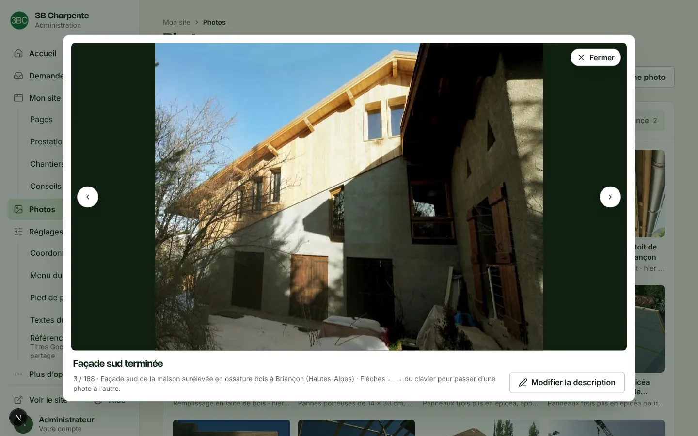

**Remplacer une photo partout sur le site.**

1. Cliquez sur **Photos** et cherchez la photo par ce qu’elle montre ou par sa commune.
2. Cliquez sur sa description pour l’ouvrir, cliquez sur la **croix** à droite du fichier, puis déposez la nouvelle photo.
3. Vérifiez le **texte alternatif** : il décrit la photo aux personnes aveugles et à Google.
4. **Enregistrer**. Toutes les pages qui utilisaient la photo affichent la nouvelle.

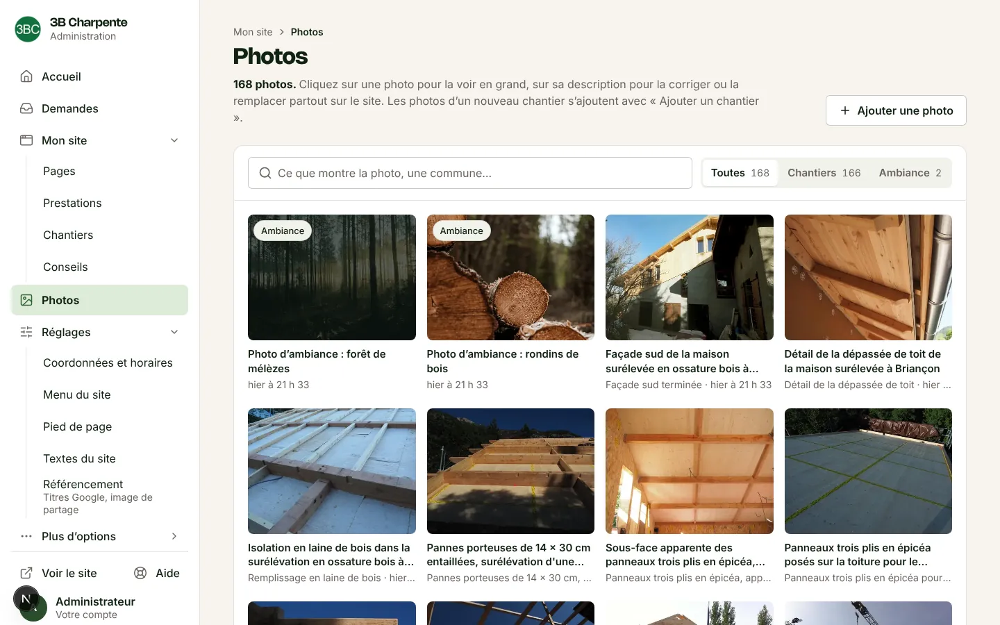
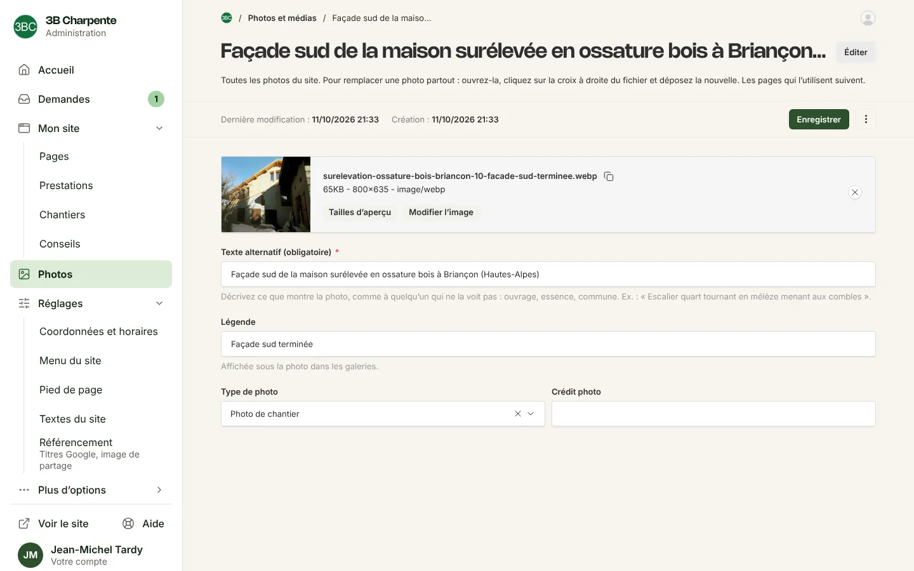
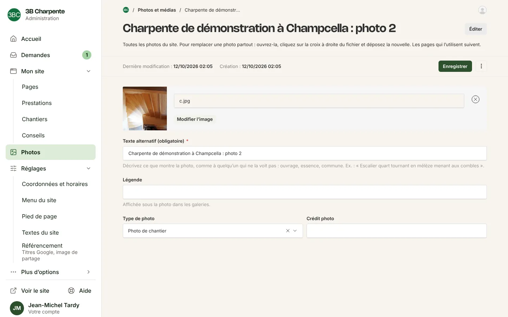

## 4. Ajouter un chantier

1. Sur l’accueil, **Ajouter un chantier** (ou **Chantiers** → **Ajouter un chantier**).
2. **Étape 1** : un titre (« Ouvrage à Commune »), la commune, les prestations concernées.
3. **Étape 2** : déposez les photos. Elles sont allégées avant l’envoi ; la première est la photo principale, glissez les autres pour changer l’ordre et ajoutez une légende.
4. **Étape 3** : une phrase de résumé et quelques phrases sur le projet. La description pour Google est proposée toute seule.
5. **Publier le chantier**. Il apparaît dans Réalisations, dans le filtre de sa commune et sur la page de ses prestations.

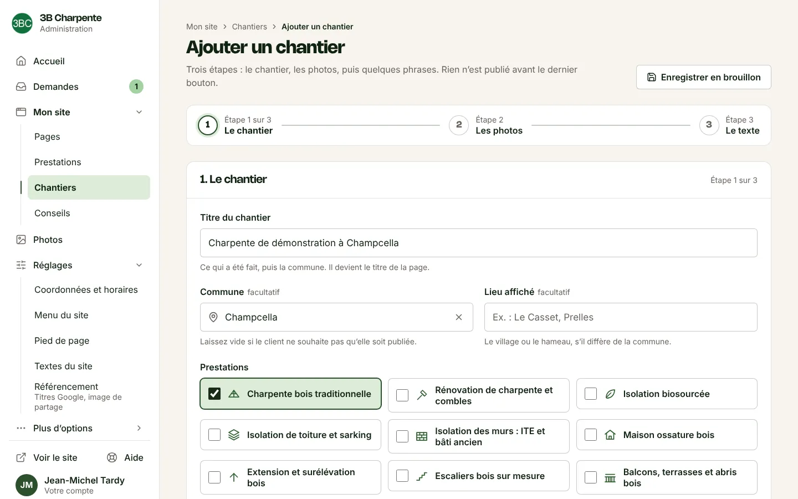
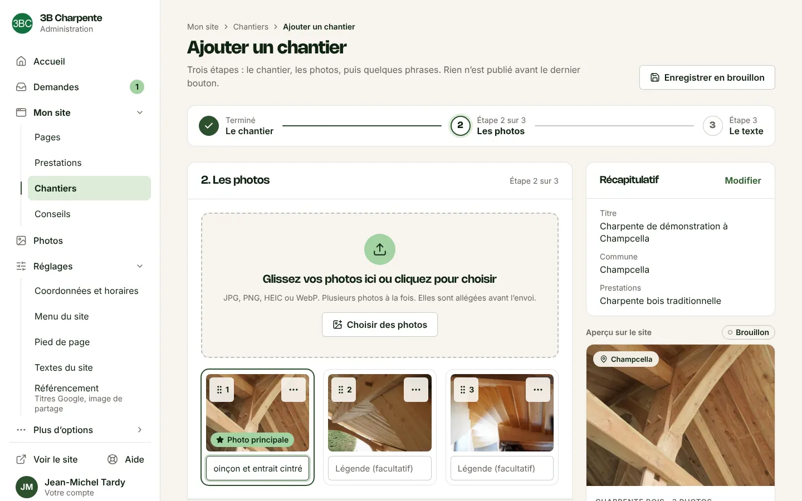
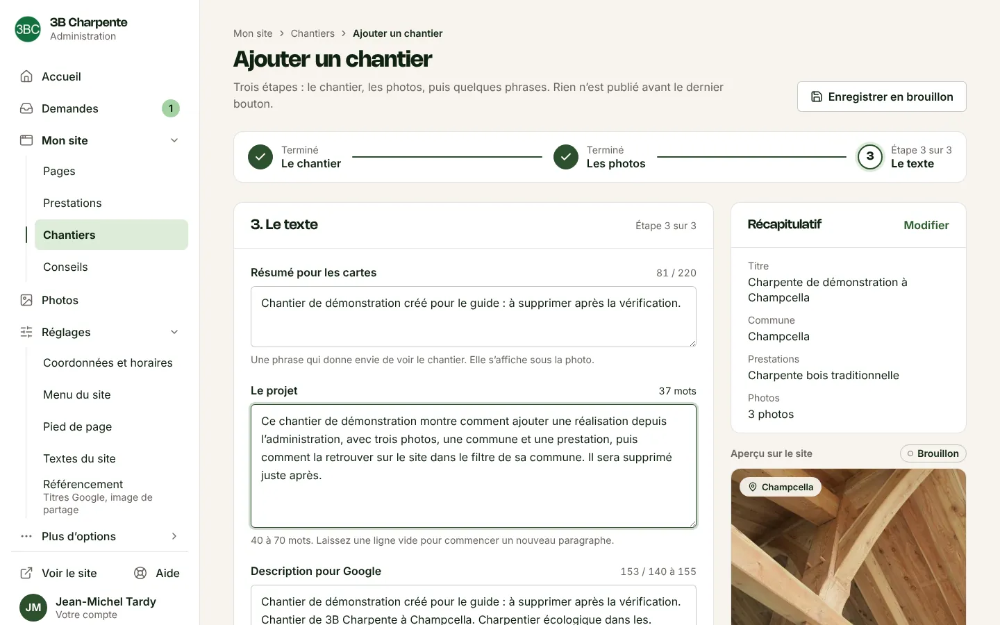
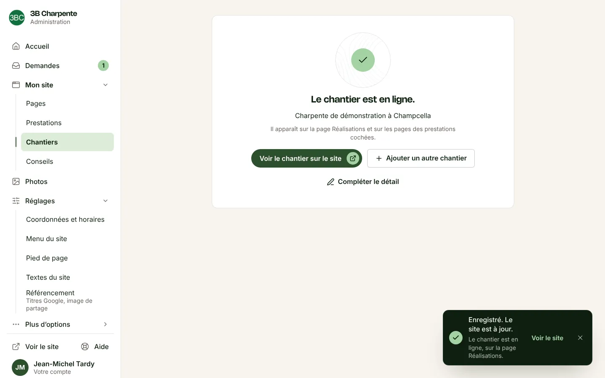

## 5. Changer les horaires (ou le téléphone)

1. **Réglages** → **Coordonnées et horaires**.
2. Pour chaque jour : l’interrupteur **Ouvert** / **Fermé**, puis les heures. **Pause de midi** ajoute une seconde plage.
3. Pour des congés : **Fermetures exceptionnelles**, avec les deux dates. Un clic sur une date ouvre un calendrier : cliquez sur le jour (les listes du haut changent de mois ou d’année, **Aujourd’hui** revient au jour même). Dans « Au », les jours avant le début sont grisés.
4. **Enregistrer**. L’aperçu noir montre le pied de page tel que vos clients le verront.

Un seul endroit pour tout le site : en-tête, pied de page, page Contact, boutons d’appel et fiche lue par Google.

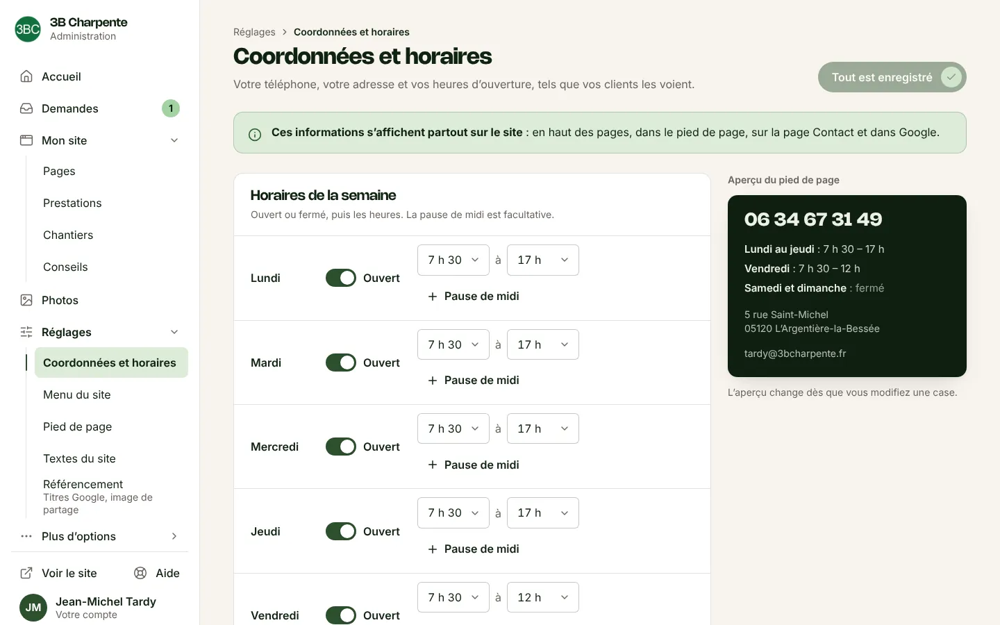

## 6. Ajouter une redirection

Quand vous changez l’adresse d’une page publiée, la redirection est **créée toute seule** : l’ancienne adresse mène à la nouvelle. À la main, seulement pour une adresse extérieure ou très ancienne :

1. **Plus d’options** → **Redirections** → **Ajouter**.
2. **Ancienne adresse** : le chemin seul, par exemple `/galerie/abris-voiture`.
3. **Rediriger vers** : une page du site (choisie dans la liste) ou une adresse précise.
4. Laissez **Définitive (301)** et **Enregistrer**.

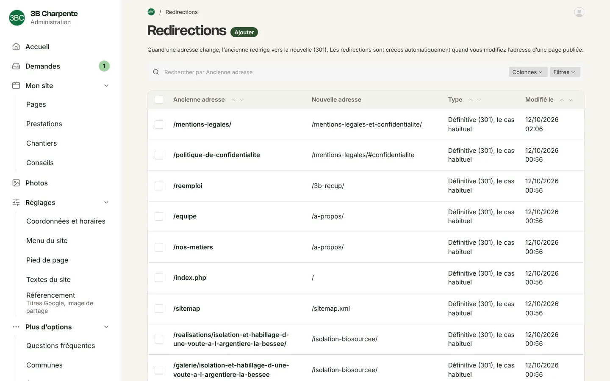
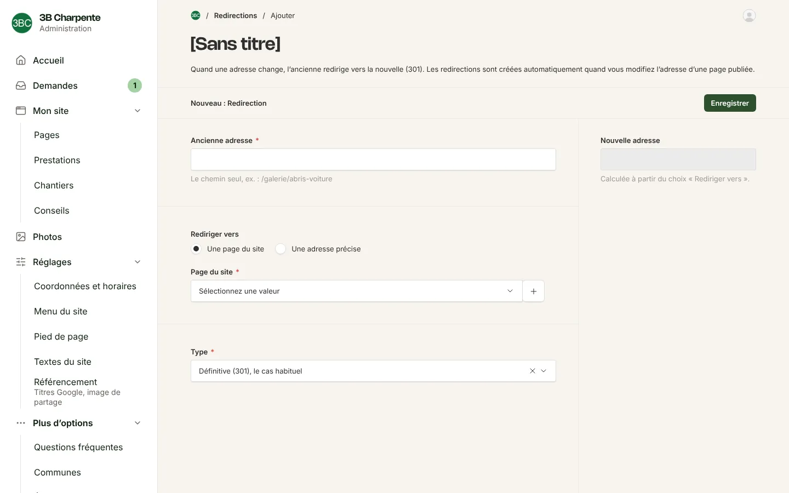

## 7. Revenir à une version précédente

Chaque page garde ses 30 dernières versions.

1. Ouvrez la page, puis l’onglet **Versions** en haut à droite.
2. Cliquez sur une date marquée **Précédemment publié** : les différences avec la version actuelle s’affichent côte à côte.
3. **Restaurer cette version** remet la page telle qu’elle était à cette date, en ligne. Pour la relire d’abord, ouvrez la petite flèche du bouton et choisissez **Restaurer comme brouillon**.

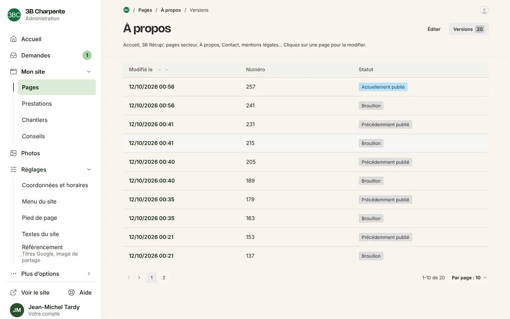
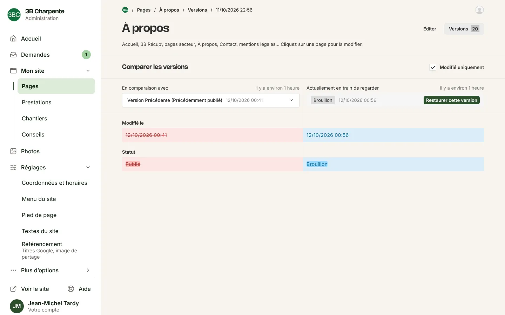

---

## Sur téléphone

Tout fonctionne aussi sur un téléphone : le menu s’ouvre avec le bouton **Menu** en haut, et une demande s’ouvre en plein écran avec les boutons **Appeler** et **Répondre**.

## Les comptes

| Compte | Rôle | Peut |
|---|---|---|
| `jean` (Jean-Michel Tardy) | Éditeur | Tout le contenu, les photos, les coordonnées, les demandes |
| `admin` | Administrateur | Tout, y compris les comptes et les réglages techniques |
| `gregoire` | Administrateur | Idem (maintenance du site) |

Les mots de passe ne sont écrits nulle part dans le code. Un administrateur ajoute un compte dans **Plus d’options** → **Comptes**.

---

## Démonstration de bout en bout

Le 12 octobre 2026, un script a joué le rôle d’un visiteur puis de Jean-Michel (compte Éditeur), dans un vrai navigateur, sur la version de production du site (`pnpm build`), et a contrôlé le résultat sur les pages publiques. Tout a ensuite été remis en état.

| # | Vérification | Résultat |
|---|---|---|
| 1 | Un visiteur envoie une demande avec le formulaire de la page Contact (téléphone) | ✅ |
| 2 | La demande arrive dans **Demandes**, statut « Nouvelle », résumé « Rénovation de charpente ou aménagement de combles à Briançon » | ✅ |
| 3 | Connexion avec le compte Éditeur `jean` : l’accueil dit « Bonjour Jean-Michel » | ✅ |
| 4 | Horaires : samedi ouvert de 8 h à 12 h → visible dans le pied de page | ✅ |
| 5 | … visible sur la page Contact | ✅ |
| 6 | … présent dans les données structurées lues par Google (`openingHoursSpecification`) | ✅ |
| 7 | Samedi remis à « fermé » : il disparaît du site et des données structurées | ✅ |
| 8 | Chantier ajouté avec l’assistant (3 photos, Champcella, Charpente bois) → présent sur la page Réalisations | ✅ |
| 9 | … rangé sous sa commune (Champcella) | ✅ |
| 10 | … visible quand on filtre les réalisations sur Champcella | ✅ |
| 11 | Photo remplacée : le nouveau fichier est enregistré (52 514 → 27 884 octets) et servi | ✅ |
| 12 | Adresse de la page Mentions légales changée → l’ancienne adresse redirige vers la nouvelle (308, redirection permanente) | ✅ |
| 13 | … et la redirection apparaît dans **Redirections** | ✅ |
| 14 | Adresse d’origine remise : `/mentions-legales/` répond de nouveau | ✅ |
| 15 | Chantier, photos et demande de démonstration supprimés | ✅ |

Aucune erreur dans la console du navigateur pendant tout le parcours. Le script est rejouable avant chaque grosse mise à jour.

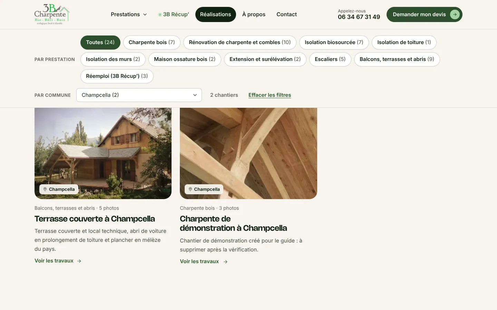
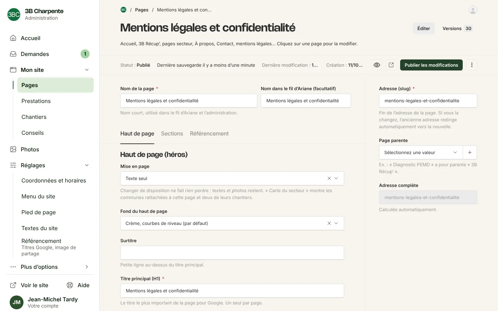
